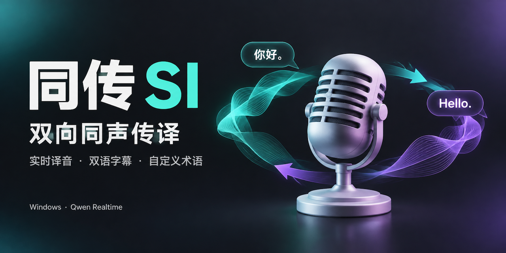

<p align="center">
  
</p>

<h1 align="center">同传 SI</h1>

<p align="center">
  <strong>让你的发言被听懂，也让对方的发言听得懂。</strong><br>
  Windows 双向同声传译 · 实时译音 · 双语字幕 · 自定义术语
</p>

<p align="center">
  
  <a href="https://www.python.org/downloads/"></a>
  <a href="https://doc.qt.io/qtforpython-6/"></a>
  <a href="LICENSE"></a>
</p>

<p align="center">
  <a href="#功能亮点">功能亮点</a> ·
  <a href="#快速开始">快速开始</a> ·
  <a href="#音频接线">音频接线</a> ·
  <a href="#使用指南">使用指南</a> ·
  <a href="#开发与验证">开发与验证</a> ·
  <a href="docs/si-architecture.md">架构文档</a>
</p>

---

**同传 SI** 是面向在线会议与跨语言交流的桌面应用，接入阿里云百炼的 `qwen3.8-livetranslate-flash-realtime` 模型。它将你的发言翻译后送入会议软件，同时把对方的发言翻译后播放到耳机，两条链路独立运行。

应用使用 **PySide6 Widgets** 构建界面，音频采集与播放由 **Qt Multimedia** 完成，支持浅色与深色主题。

## 功能亮点

| 功能 | 说明 |
| :--- | :--- |
| 🎙️ 双向实时译音 | 上行「我的发言」与下行「对方发言」使用独立音频链路和实时会话，可同时运行 |
| 🎛️ 独立控制 | 每路分别开始、暂停、恢复、停止、静音和调节音量，支持全局紧急静音 |
| 💬 双语字幕 | 原文与译文独立显示，支持按方向筛选、自动跟随和手动导出 |
| 🗣️ 语言与音色 | 界面提供 29 种目标语言选项、7 个音色预设，每路可单独选择 |
| 📖 自定义术语 | 为两个方向分别配置术语表，在会话建立时发送给模型 |
| 🔐 凭据管理 | 可将密钥保存在 Windows 凭据管理器，普通配置文件不包含 API Key |
| 🧰 诊断与恢复 | 本地设备测试、运行日志查看器、有限次数自动重连和音频积压保护 |

## 快速开始

### 1. 准备环境

| 项目 | 要求 |
| :--- | :--- |
| 操作系统 | Windows |
| Python | 3.12 或更高版本 |
| 包管理器 | [uv](https://docs.astral.sh/uv/getting-started/installation/) |
| 模型服务 | 阿里云百炼 API Key、业务空间 ID，以及对应地域的实时同传模型权限 |
| 音频设备 | 麦克风与耳机；接入会议软件时，还需两条独立的虚拟音频连接 |

### 2. 安装并启动

在 PowerShell 中执行：

```powershell
git clone https://github.com/KT-network/SI.git
cd SI
uv sync --group dev
uv run python -m si
```

在项目目录中也可使用启动脚本：

```powershell
.\run.ps1
```

### 3. 完成首次配置

1. 打开右上角的 **设置**，填写服务地域、业务空间 ID 和 API Key。界面支持北京、新加坡地域，地域需与业务空间及密钥匹配。
2. 按[音频接线](#音频接线)为「我的发言」「对方发言」选择输入、输出设备。
3. 分别选择目标语言与音色；默认将我的发言译为英语、对方发言译为中文，音色为 Tina。
4. 点击每路的设备测试按钮，检查输入电平和输出提示音。
5. 按需启动单个方向，或点击顶部 **开始双向**。

> [!NOTE]
> 首次打开应用不会自动录音、播放或连接模型 API。设备测试仅在本地采集约三秒输入电平并播放低音量提示音，不上传音频。

> [!IMPORTANT]
> 实时翻译会将对应链路的音频发送至阿里云百炼，并可能产生 API 费用。模型权限、价格与地域可用性以服务端为准。

## 音频接线

会议场景需要 **两条相互独立的虚拟音频连接**，例如 [VB-CABLE A/B](https://vb-audio.com/Cable/)。单条虚拟音频线无法同时承担这两条隔离链路；驱动需自行安装，应用不会安装或修改系统音频驱动。

以 VB-CABLE A/B 的常见设备名称为例：

| 设置位置 | 选择的设备 | 用途 |
| :--- | :--- | :--- |
| SI · 我的发言输入 | 真实麦克风 | 采集你的原声 |
| SI · 我的发言输出 | `CABLE-A Input` | 将你的译音写入虚拟线 A |
| 会议软件 · 麦克风 | `CABLE-A Output` | 将你的译音发送给对方 |
| 会议软件 · 扬声器 | `CABLE-B Input` | 将对方的原声写入虚拟线 B |
| SI · 对方发言输入 | `CABLE-B Output` | 采集对方的原声 |
| SI · 对方发言输出 | 真实耳机或扬声器 | 播放对方发言的译音 |

```text
我的发言：麦克风 → SI 上行 → Qwen 实时翻译 → 虚拟线 A → 会议软件麦克风
对方发言：会议软件扬声器 → 虚拟线 B → SI 下行 → Qwen 实时翻译 → 耳机
```

虚拟设备名称中的 `Input` 是播放写入端，`Output` 是录音采集端。应用保存设备 ID；设备断开后会显示不可用，不会自动切换到其他设备。

> [!TIP]
> 建议先使用耳机验证双向链路。当前版本尚未接入声学回声消除（AEC）；扬声器外放可能被麦克风再次拾取，造成译音回流。

## 使用指南

### 双路控制

| 操作 | 行为 |
| :--- | :--- |
| 开始 / 恢复 | 为该方向建立实时会话；音频设备成功启动后显示「翻译中」 |
| 暂停 | 停止上传并结束当前会话，恢复时建立新会话 |
| 停止 | 停止该方向并释放对应会话与音频资源 |
| 静音 | 清空该方向待播音频，会话继续运行，仍会上传音频 |
| 紧急静音 | 同时静音两路译音；需要结束翻译时使用「全部停止」 |

目标语言、音色和音频设备可在停止或暂停后修改，下次开始或恢复时生效。托盘菜单可显示、隐藏窗口、紧急静音及停止翻译；关闭窗口会停止两条链路并释放音频和网络线程。

### 字幕与导出

- 原文与译文显示开关互相独立，隐藏字幕不影响译音，也不会关闭服务端原文识别。
- 字幕按方向、会话与语音片段关联，最终结果替换增量结果，最多保留最近 **300 段**。
- 默认不将音频或字幕保存到磁盘。需要导出时，在 **设置 → 字幕导出** 中选择各方向的原文、译文，再点击导出按钮。
- 导出文件为 UTF-8 文本，仅包含当前保留且已完成、允许导出的字幕。

### 音色与术语

每路「译为」旁的「音色」菜单可独立选择并自动保存。启动采集前，应用会核对服务端确认的音色；配置缺失或不一致时显示错误并记录日志。

<details>
<summary>查看 7 个音色预设</summary>

| 音色 ID | 显示名称 | 界面描述 |
| :--- | :--- | :--- |
| `Tina` | 甜甜 | 甜美温暖，默认音色 |
| `Serena` | 苏瑶 | 温柔自然 |
| `Ethan` | 晨煦 | 阳光温暖 |
| `Maia` | 四月 | 知性温柔 |
| `Katerina` | 卡捷琳娜 | 成熟、韵律丰富 |
| `Ryan` | 甜茶 | 节奏鲜明、富有张力 |
| `Theo Calm` | 予安 | 平静舒缓 |

上述预设于 2026-10-09 在北京地域完成 API 配置确认验证，未录音或上传音频；实际听感与其他地域仍需验证。旧配置缺少音色字段时使用 Tina。

</details>

术语表在 **设置 → 术语表** 中按「我的发言」「对方发言」分别维护，用于配置专有名词及其译法，并在会话建立前发送给服务端。各语言和音色的实际支持情况以模型返回为准。

## 配置与隐私

- **普通设置**：设备、语言、音色、主题、术语表和导出选项保存为本地 JSON 配置，API Key 不写入该文件。
- **密钥保存**：「在 Windows 凭据管理器中保存密钥」默认选中，写入后立即读回校验；重启后自动加载，已保存密钥优先于环境变量。
- **仅本次使用**：取消保存密钥会移除当前地域、业务空间对应的已存凭据，界面填写的密钥仅用于当前进程。
- **音频与字幕**：应用不自动保存原始音频或字幕；实时翻译期间会向模型服务发送音频，配置术语表时也会发送术语。
- **运行日志**：不记录原始音频、完整 API 消息、字幕内容或术语表，API Key 与鉴权字段会脱敏。

也可在启动前通过环境变量提供初始配置：

```powershell
$env:DASHSCOPE_API_KEY = "<你的 API Key>"
$env:DASHSCOPE_WORKSPACE_ID = "<你的业务空间 ID>"
uv run python -m si
```

已有配置中的业务空间 ID 优先于环境变量；启用凭据保存时，已存密钥优先于 `DASHSCOPE_API_KEY`。应用不会自动读取 `.env` 文件。

## 日志与排错

点击主界面右上角的 **查看运行日志** 图标，或使用托盘菜单，可查看实时日志、筛选错误、复制堆栈和选择历史文件。查看器会显示实际日志路径，并提供打开文件夹按钮。

默认日志位置通常为：

```text
%LOCALAPPDATA%\SI\SI\logs\si.log
```

日志文件上限为 **5 MiB**，保留 **5 份**历史文件；正常退出时等待待写日志落盘。打包环境可能将路径重定向到应用的 LocalCache 目录，以查看器显示的路径为准。目录不可写时，会回退到系统临时目录下的 `SI-logs` 并提示。

```powershell
# 输出更详细的诊断信息
uv run python -m si --log-level DEBUG

# 指定日志目录
uv run python -m si --log-dir D:\SI-logs

# 列出可用输入、输出设备
uv run python -m si --list-devices
```

| 现象 | 建议检查 |
| :--- | :--- |
| 缺少虚拟设备或显示已断开 | 确认驱动已安装，刷新设备列表并重新选择端点 |
| 对方听不到你的译音 | 确认 SI 上行输出与会议软件麦克风分别选择线 A 的写入端、采集端 |
| 听不到对方发言的译音 | 确认会议软件扬声器与 SI 下行输入连接线 B，检查下行输出、音量与静音状态 |
| 译音反复回流 | 检查两路是否误用同一条虚拟线，使用耳机避免外放被麦克风拾取 |
| 鉴权、参数或音色配置错误 | 核对地域、业务空间、密钥和模型权限，查看日志中的服务端错误 |
| 显示重连或音频积压错误 | 检查网络与音频设备，必要时停止该方向后重新启动 |

网络瞬断会进行有限次数的指数退避重连，鉴权或参数错误会直接显示故障。上传积压超过约 **500 ms** 时重新同步，译音积压超过 **8 秒** 时停止对应方向。重连会清理旧缓冲并隔离迟到数据，跨会话语境不保证连续。

## 开发与验证

桌面应用的离线测试与启动检查：

```powershell
uv sync --group dev
uv run pytest -q --ignore=tests/test_realtime_script.py
uv run python -m si --smoke-test
```

离线测试覆盖协议握手、音频发送与关闭、双路隔离、字幕关联、格式转换、队列边界、配置、日志和 GUI 行为。`--smoke-test` 会打开窗口并自动关闭，不启动翻译。

`tests/test_realtime_script.py` 依赖本地历史原型 `test_1.py`，不属于 `src/si/` 桌面应用；上述测试命令排除该原型测试，避免新克隆的仓库因缺少原型文件而无法收集测试。

<details>
<summary>检查服务端音色配置</summary>

```powershell
uv run python tools/check_voice_api.py Serena
```

此工具使用应用配置连接真实 API，验证当前地域的音色配置，不启动音频设备，也不录音或上传音频。它需要有效的凭据与模型权限。

</details>

实际模型权限、计费、端到端延迟、音色听感、虚拟驱动路由和会议软件兼容性仍需在真实环境中验证。

## 项目结构

```text
SI/
├── src/si/                 # 桌面应用
│   ├── main.py            # 启动入口与命令行选项
│   ├── domain.py          # 配置、语言、音色与状态定义
│   ├── controller.py      # 双向链路控制
│   ├── realtime.py        # WebSocket 会话与重连
│   ├── protocol.py        # 服务端协议解析与配置确认
│   ├── audio.py           # Qt 音频设备采集与播放
│   ├── audio_buffers.py   # 音频缓冲与流式重采样
│   ├── transcripts.py     # 字幕归并与导出
│   ├── storage.py         # 配置与系统凭据管理
│   ├── diagnostics.py     # 日志与异常诊断
│   └── ui/                # 主窗口、设置、字幕与日志界面
├── tests/                 # 自动化测试
├── tools/                 # 设备检查、音色验证与界面渲染工具
├── docs/                  # 架构说明、架构图与项目横幅
├── pyproject.toml         # 项目依赖与打包配置
├── run.ps1                # Windows 启动脚本
└── LICENSE                # BSD 3-Clause 许可证
```

更多实现说明见 [架构文档](docs/si-architecture.md)，音频与会话关系见 [架构图预览](docs/si-architecture.visual-check.1440x900.light.png)；可下载并在浏览器中打开 [交互式架构图](docs/si-architecture.html)。

## 许可证

本项目采用 [BSD 3-Clause License](LICENSE)。第三方模型服务和虚拟音频驱动的使用、费用与授权以各自提供方的条款为准。
